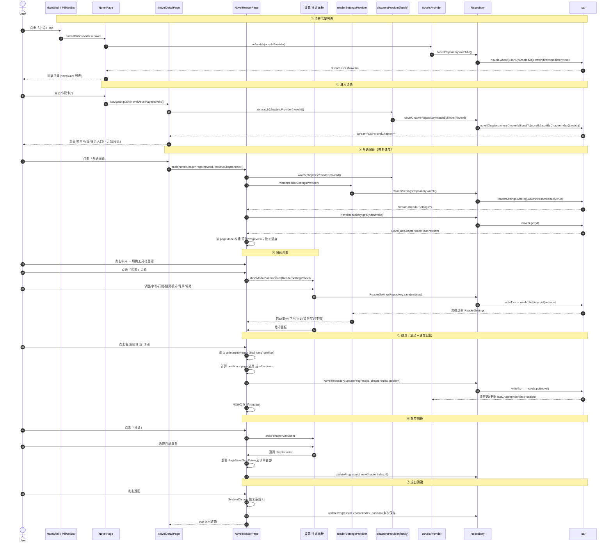

# 以越之名 · 小说功能模块 — 架构设计 + 任务分解

> 作者：架构师 高见远
> 基线：严格对齐 `CLAUDE.md` 与现有 `wish_repository` / `data_providers` / `wishes_page` 范式
> 技术栈：Flutter 3.x / Dart 3.5+ · Riverpod · Isar（本地优先，纯离线）

---

## 1. 实现方案 + 框架选型

### 1.1 核心难点
| 难点 | 方案 |
|---|---|
| 章节文本分页（翻页模式） | 用核心库 `TextPainter`（`computeLineMetrics()` 测每行高度/基线，`getPositionForOffset` 反推字符偏移）按可用高度切分为多页字符串，再用 `PageView` 承载 |
| 沉浸式阅读 | `services` 库 `SystemChrome.setEnabledSystemUIMode(SystemUiMode.immersiveSticky)` 进入、`SystemUiMode.manual` 恢复 |
| 进度记忆（比例 0..1） | `Novel.lastPosition` 存比例；滚动用 `ScrollController` 跳 `offset = ratio * maxExtent`，翻页用 `PageController` 跳 `page = (ratio * totalPages).round()` |
| 实时刷新 | 沿用既有 `Repository → StreamProvider(fireImmediately:true) → Widget .when()` 链路，新增 3 个 Repository + 3 个 Provider |

### 1.2 框架选型结论
- **不引入任何第三方依赖**。分页（`TextPainter`）、沉浸（`SystemChrome`）、布局（`Builder`/`LayoutBuilder`/`SingleChildScrollView`/`PageView`）均为 Flutter 核心/SDK 自带。
- 状态管理、数据库、路由沿用既有 `flutter_riverpod` + `isar` + `IndexedStack` 底部导航，阅读页作为独立 `Navigator.push` 路由（不入栈 Tab）。

### 1.3 架构分层（沿用 `CLAUDE.md` 2.1）
```
features/novel/presentation/*  (Widget 只 ref.watch / ref.read)
        ↓
data/repositories/*            (CRUD + Stream，包裹 writeTxn)
        ↓
Isar (novels / novelChapters / readerSettings)
```
> ❌ 禁止 Widget 直接操作 `Isar`；❌ 禁止跨层调用；✅ 颜色来自 `AppColors`、字号来自 `AppTextStyles`。

---

## 2. 文件列表（区分新增 / 修改）

### 新增（12 个）
| 文件 | 说明 |
|---|---|
| `lib/data/models/novel.dart` | `Novel` 集合（书架条目） |
| `lib/data/models/novel_chapter.dart` | `NovelChapter` 集合（章节正文） |
| `lib/data/models/reader_settings.dart` | `ReaderSettings` 集合（单例行） |
| `lib/data/repositories/novel_repository.dart` | 书架 CRUD + `watchAll` + `updateProgress` |
| `lib/data/repositories/novel_chapter_repository.dart` | 章节 `watchByNovel` / `getByNovelAndIndex` / `addAll` / `deleteByNovel` |
| `lib/data/repositories/reader_settings_repository.dart` | 阅读设置 单例 `getOrCreate` / `watch` / `save` |
| `lib/features/novel/presentation/novel_page.dart` | 书架列表页（新 Tab 落地页） |
| `lib/features/novel/presentation/novel_detail_page.dart` | 详情页（开始阅读 + 目录入口） |
| `lib/features/novel/presentation/novel_reader_page.dart` | 沉浸式阅读页（核心，ConsumerStatefulWidget） |
| `lib/features/novel/presentation/widgets/novel_card.dart` | 书架卡片 |
| `lib/features/novel/presentation/widgets/reader_settings_sheet.dart` | 阅读设置底部面板 |
| `lib/features/novel/presentation/widgets/chapter_list_sheet.dart` | 章节目录底部面板 |

### 修改（8 个）
| 文件 | 改动点 |
|---|---|
| `lib/app/theme/app_colors.dart` | 新增「阅读器背景主题」小节（`readerBgXxx` / `readerTextOnXxx`） |
| `lib/data/providers/data_providers.dart` | 新增 3 个 Repository Provider + `novelsProvider` + `chaptersProvider`(family) + `readerSettingsProvider` |
| `lib/data/database/isar_provider.dart` | `isarSchemas` 增加 `NovelSchema` / `NovelChapterSchema` / `ReaderSettingsSchema` |
| `lib/shared/widgets/pill_nav_bar.dart` | `NavTab` 枚举增加 `novel`（label '小说'，icon `Icons.menu_book_rounded`） |
| `lib/shared/layouts/main_shell.dart` | `IndexedStack.children` 在 `profile` 前插入 `NovelPage()` |
| `lib/core/constants/seed_data.dart` | 新增 `novels()` / `novelChapters(List<Novel>)` 预置示例 |
| `lib/data/database/seed_service.dart` | `_seed()` 写入示例小说 + 章节（幂等） |
| `test/widget_test.dart` | 为新 Provider 增加 override（含 `chaptersProvider` family override） |

---

## 3. 数据结构与接口

### 3.1 模型字段表

#### Novel（`lib/data/models/novel.dart`）
| 字段 | 类型 | 约束 | 说明 |
|---|---|---|---|
| `id` | `Id` | `Isar.autoIncrement` | 主键 |
| `title` | `String` | `late` | 书名 |
| `author` | `String` | `late` | 作者 |
| `intro` | `String` | `late` | 简介 |
| `coverColorValue` | `int` | `late` | 封面渐变占位色（`Color().value`） |
| `tags` | `List<String>` | `late` | 标签（Isar scalar list） |
| `chapterCount` | `int` | `late` | 章节数 |
| `isBuiltin` | `bool` | `late` | 是否预置（种子） |
| `lastChapterIndex` | `int` | `late`，默认 `-1` | 最近阅读章节下标（-1=未读） |
| `lastPosition` | `double` | `late`，默认 `0.0` | 阅读进度比例 0..1 |
| `lastReadAt` | `DateTime?` | 可空 | 最近阅读时间 |
| `createdAt` | `DateTime` | `late` | 创建时间（`sortByCreatedAt`） |

#### NovelChapter（`lib/data/models/novel_chapter.dart`）
| 字段 | 类型 | 约束 | 说明 |
|---|---|---|---|
| `id` | `Id` | `Isar.autoIncrement` | 主键 |
| `novelId` | `int` | `late`，`@Index()` | 所属小说 id（关联） |
| `chapterIndex` | `int` | `late` | 章序号（从 0 递增，用于排序） |
| `title` | `String` | `late` | 章节标题 |
| `content` | `String` | `late` | 章节正文（短文本） |

#### ReaderSettings（`lib/data/models/reader_settings.dart`，单例集合）
| 字段 | 类型 | 约束 | 说明 |
|---|---|---|---|
| `id` | `Id` | `Isar.autoIncrement` | 主键 |
| `fontSize` | `double` | `late`，范围 16~24 | 正文字号 |
| `lineHeight` | `double` | `late`，范围 1.2~2.0 | 行距倍率 |
| `pageMode` | `int` | `late`，`0` 滚动 / `1` 翻页 | 翻页模式 |
| `bgTheme` | `int` | `late`，`0`白/`1`米黄/`2`粉/`3`护眼绿/`4`夜间 | 背景主题 |
| `keepScreenOn` | `bool` | `late` | 常亮 |

### 3.2 Repository 方法签名

```dart
// novel_repository.dart
class NovelRepository {
  NovelRepository(this._isar);
  final Isar _isar;
  Future<List<Novel>> getAll();
  Stream<List<Novel>> watchAll();                 // sortByCreatedAt + fireImmediately
  Future<Novel?> getById(Id id);
  Future<void> add(Novel novel);                  // writeTxn
  Future<void> update(Novel novel);               // writeTxn
  Future<void> delete(Id id);                     // writeTxn
  Future<void> updateProgress(Id id, int chapterIndex, double position); // writeTxn
}

// novel_chapter_repository.dart
class NovelChapterRepository {
  NovelChapterRepository(this._isar);
  final Isar _isar;
  Stream<List<NovelChapter>> watchByNovel(int novelId);   // novelIdEqualTo + sortByChapterIndex + fireImmediately
  Future<NovelChapter?> getByNovelAndIndex(int novelId, int chapterIndex);
  Future<void> addAll(List<NovelChapter> chapters);        // writeTxn
  Future<void> deleteByNovel(int novelId);                // writeTxn
}

// reader_settings_repository.dart
class ReaderSettingsRepository {
  ReaderSettingsRepository(this._isar);
  final Isar _isar;
  Future<ReaderSettings> getOrCreate();          // 首条为空则写默认
  Stream<ReaderSettings?> watch();               // fireImmediately + map 首条
  Future<void> save(ReaderSettings settings);    // writeTxn
}
```

> 写操作全部包裹 `_isar.writeTxn()`；`watchAll` / `watchByNovel` / `watch` 均 `fireImmediately:true`。

### 3.3 Provider 签名（`data_providers.dart`）
```dart
// Repository providers
final novelRepositoryProvider = Provider((ref) =>
    NovelRepository(ref.watch(isarProvider)));
final novelChapterRepositoryProvider = Provider((ref) =>
    NovelChapterRepository(ref.watch(isarProvider)));
final readerSettingsRepositoryProvider = Provider((ref) =>
    ReaderSettingsRepository(ref.watch(isarProvider)));

// Data stream providers
final novelsProvider = StreamProvider<List<Novel>>((ref) =>
    ref.watch(novelRepositoryProvider).watchAll());

final chaptersProvider =
    StreamProvider.family<List<NovelChapter>, int>((ref, novelId) =>
        ref.watch(novelChapterRepositoryProvider).watchByNovel(novelId));

final readerSettingsProvider = StreamProvider<ReaderSettings?>((ref) =>
    ref.watch(readerSettingsRepositoryProvider).watch());
```

### 3.4 Isar accessor 名称约定（以 `.g.dart` 为准）
按 CLAUDE.md 2.3 的复数化规则（`AppSettings`→`appSettings` 已验证"以 s 结尾不再加 s"），推断为：
`Novel → novels`、`NovelChapter → novelChapters`、`ReaderSettings → readerSettings`。
**实现 T01 后必须打开 `* .g.dart` 核对实际生成的 accessor 名；若不一致，本表与 Repository 内的调用名同步修正。**

---

## 4. 程序调用流程（时序图）



---

## 5. 任务列表（有序 · 含依赖 · 逐文件）

> 说明：本项目为既有工程，无新增配置/依赖，故"基础设施"根任务改为**数据模型层 T01**（依赖根）。
> 任务按依赖顺序排列；工程师可逐文件实现。所有 Isar 模型写完后需执行
> `dart run build_runner build --delete-conflicting-outputs` 生成 `.g.dart`，并核对 accessor 名。

### T01 — 数据模型层（新增 3 个 @collection）
- **依赖**：无
- **产出文件**：
  - `lib/data/models/novel.dart`
  - `lib/data/models/novel_chapter.dart`
  - `lib/data/models/reader_settings.dart`
- **要点**：严格按 §3.1 字段表；`NovelChapter.novelId` 加 `@Index()`；`ReaderSettings` 为单例行；三个文件均 `part '*.g.dart'`；写毕运行 build_runner 并核对 accessor 名。

### T02 — Repository 层（新增 3 个 Repository）
- **依赖**：T01
- **产出文件**：
  - `lib/data/repositories/novel_repository.dart`
  - `lib/data/repositories/novel_chapter_repository.dart`
  - `lib/data/repositories/reader_settings_repository.dart`
- **要点**：方法签名见 §3.2；写操作包 `writeTxn`；`watchAll/watchByNovel/watch` 用 `fireImmediately:true`；`updateProgress` 在事务内读取→改 `lastChapterIndex/lastPosition/lastReadAt`→put；`getOrCreate` 首条为空则写默认值（fontSize 18、lineHeight 1.6、pageMode 0、bgTheme 0、keepScreenOn true）。

### T03 — Provider + Schema 集中注册
- **依赖**：T01、T02
- **产出文件**：
  - `lib/data/providers/data_providers.dart`（修改：追加 §3.3 的 3 个 repo provider + 3 个 stream/family provider）
  - `lib/data/database/isar_provider.dart`（修改：`isarSchemas` 增加 `NovelSchema`/`NovelChapterSchema`/`ReaderSettingsSchema`）
- **要点**：Provider 定义集中在 `data_providers.dart`（CLAUDE.md 2.2）；`chaptersProvider` 用 `StreamProvider.family`；import 三个新 repository 与新 model。

### T04 — 阅读器主题色（设计系统扩展）
- **依赖**：无（可与 T01~T03 并行）
- **产出文件**：
  - `lib/app/theme/app_colors.dart`（修改：新增「阅读器背景主题」小节）
- **要点**：新增 `readerBgWhite/readerBgCream/readerBgPink/readerBgGreen/readerBgDark` 与对应文字色 `readerTextOnWhite/readerTextOnCream/readerTextOnPink/readerTextOnGreen/readerTextOnDark`；**禁止**在阅读页硬编码颜色，统一取 `AppColors`。映射：bgTheme 0→White、1→Cream、2→Pink、3→Green、4→Dark。

### T05 — 书架列表页 + 小说卡片
- **依赖**：T03、T04
- **产出文件**：
  - `lib/features/novel/presentation/novel_page.dart`
  - `lib/features/novel/presentation/widgets/novel_card.dart`
- **要点**：`NovelPage` 用 `ref.watch(novelsProvider)` 经 `.when()` 三态渲染（`ConsumerWidget`）；顶部标题"小说"（`AppTextStyles.titleLarge`）；空状态按 CLAUDE.md 3.4 友好提示；`NovelCard` 展示封面色块（`coverColorValue`）、标题、作者、标签、"读到 X%"（`lastPosition`）；整卡 `GestureDetector` 跳 `NovelDetailPage(novel.id)`；卡片布局遵循 `AppColors.radiusCard/bgCard/shadowCard` 令牌。

### T06 — 详情页
- **依赖**：T03、T04、T05
- **产出文件**：
  - `lib/features/novel/presentation/novel_detail_page.dart`
- **要点**：`ConsumerWidget`；`ref.watch(chaptersProvider(novelId))` 取章节列表（`.when()` 三态）；展示封面、标题、作者、简介、标签 `Wrap`、章节数、"开始阅读"按钮；`resumeIndex = novel.lastChapterIndex < 0 ? 0 : novel.lastChapterIndex`；点"开始阅读"→ `Navigator.push(NovelReaderPage(novelId: novel.id, initialChapterIndex: resumeIndex))`；提供"目录"入口（复用 `chapter_list_sheet`）。

### T07 — 阅读页核心（ConsumerStatefulWidget）
- **依赖**：T03、T04、T06
- **产出文件**：
  - `lib/features/novel/presentation/novel_reader_page.dart`
- **要点**（设计规格，非完整代码）：
  - `initState`：`SystemChrome.setEnabledSystemUIMode(SystemUiMode.immersiveSticky)`；`dispose` 恢复 `SystemUiMode.manual`（overlays 全开）+ 末次 `updateProgress`。
  - 数据源：`watch(chaptersProvider(novelId))` + `watch(readerSettingsProvider)`；章节列表按 `chapterIndex` 排序后定位 `currentChapterIndex`（初始 = `initialChapterIndex`）。
  - **滚动模式（pageMode==0）**：`SingleChildScrollView` + `ScrollController`；正文用 `Text`（`fontSize`/`height=lineHeight`/`color=readerTextOnXxx`）。进度 `position = controller.offset / controller.position.maxExtent`；恢复：`WidgetsBinding.instance.addPostFrameCallback` 中 `controller.jumpTo(ratio*maxExtent)`。
  - **翻页模式（pageMode==1）**：`PageView` + 预切分多页字符串。
    - 分页算法：用 `TextPainter` 以 `contentWidth`（LayoutBuilder 取）、`fontSize`、`height=lineHeight` `layout()`；`computeLineMetrics()` 取每行 `baseline`/`height`；`linesPerPage = ((availH - 2*padding) / (fontSize*lineHeight)).floor()`；按 `linesPerPage` 分组，用 `painter.getPositionForOffset(Offset(0, metrics[i].baseline))` 反推起止字符偏移切出每页 `substring`。
    - 用 `PageController`；进度 `position = page / totalPages`；恢复 `controller.jumpToPage((ratio*totalPages).round())`。
  - **点击分区**：`GestureDetector` 将屏幕分左/中/右三区（用 `LayoutBuilder`/`MediaQuery` 宽度的 1/3）：左=上一页/上滚一屏，中=切换顶/底工具栏 `Visibility`，右=下一页/下滚一屏。
  - **顶栏**：章节标题 + 返回 + 目录（开 `chapter_list_sheet`）；**底栏**：上一章/下一章 + 设置（开 `reader_settings_sheet`）+ 进度文本。
  - **进度记忆**：翻页/滚动变化时（节流 ~500ms）`ref.read(novelRepositoryProvider).updateProgress(novelId, currentChapterIndex, position)`；切换章节时 `updateProgress(..., 0)`。
  - 异步后一律 `if (!context.mounted) return;`；颜色/字号取自 `AppColors`/`AppTextStyles`。

### T08 — 阅读器子组件（设置面板 + 目录面板）
- **依赖**：T03、T04、T07
- **产出文件**：
  - `lib/features/novel/presentation/widgets/reader_settings_sheet.dart`
  - `lib/features/novel/presentation/widgets/chapter_list_sheet.dart`
- **要点**：两者均为 `ConsumerStatefulWidget` + `showModalBottomSheet(isScrollControlled:true)`（参照 `add_wish_sheet.dart` 范式）。
  - `reader_settings_sheet`：字号 `Slider`(16~24)、行距 `Slider`(1.2~2.0)、翻页模式 `SegmentedButton`(滚动/翻页)、背景主题 `Wrap` 色块选(5 选 1)、常亮 `Switch`；改动后 `ref.read(readerSettingsRepositoryProvider).save(settings)` + `AppSnackbar.show(context,'已保存')`，`readerSettingsProvider` 自动刷新阅读页。
  - `chapter_list_sheet`：`ref.watch(chaptersProvider(novelId))` 列出章节，高亮当前章，点击回调 `onSelect(chapterIndex)` 关闭并触发阅读页跳章。

### T09 — 导航集成（Tab + 主壳）
- **依赖**：T05（NovelPage 已存在）
- **产出文件**：
  - `lib/shared/widgets/pill_nav_bar.dart`（修改）
  - `lib/shared/layouts/main_shell.dart`（修改）
- **要点**：`NavTab` 枚举在 `wishes` 后、`profile` 前插入 `novel`；`NavTabX` 的 `label` 返回 '小说'、`icon` 返回 `Icons.menu_book_rounded`；`MainShell.IndexedStack.children` 按 `NavTab.values` 顺序在 `ProfilePage()` 前插入 `const NovelPage()`（保持 enum 顺序与 children 顺序一致，索引即 `currentTab.index`）。

### T10 — 种子数据（预置示例小说）
- **依赖**：T01
- **产出文件**：
  - `lib/core/constants/seed_data.dart`（修改）
  - `lib/data/database/seed_service.dart`（修改）
- **要点**：`Seed` 新增 `novels()` 返回 1~2 本 `isBuiltin=true` 的 `Novel`（`chapterCount` 与后续章节数一致，`tags` 用 `List<String>`）；新增 `novelChapters(List<Novel> seeded)` —— 入参为已 `putAll` 并拿到 `id` 的小说列表，按 `novelId` 归属生成 3~5 章短文本（`chapterIndex` 从 0 递增，`content` 为几段中文短文本）。
  - `seed_service._seed()` 内（同一 `writeTxn`）：先 `novels.putAll(Seed.novels())` 拿到 id → 再 `novelChapters.putAll(Seed.novelChapters(已写入的小说列表))`。保持 `seedIfEmpty` 幂等。

### T11 — 测试同步（widget_test override）
- **依赖**：T03
- **产出文件**：
  - `test/widget_test.dart`（修改）
- **要点**：在 `ProviderScope(overrides:)` 中新增：`novelsProvider.overrideWith((ref) => Stream.value([]))`；`chaptersProvider.overrideWith((ref, novelId) => Stream.value([]))`（family 写法）；`readerSettingsProvider.overrideWith((ref) => Stream.value(ReaderSettings()..fontSize=18..lineHeight=1.6..pageMode=0..bgTheme=0..keepScreenOn=true))`。确保冒烟测试渲染 `MainShell` 时 `NovelPage` 不被新 Provider 阻塞。

---

## 6. 依赖包列表

**无新增依赖。**

理由：分页（`TextPainter`）、沉浸式（`SystemChrome`，来自 `services`）、`PageView`/`SingleChildScrollView`/`LayoutBuilder` 均为 Flutter SDK 自带；数据库与状态管理沿用既有 `isar` / `flutter_riverpod`。仅需在 `pubspec.yaml` 现有依赖下运行 `dart run build_runner build` 生成 Isar `.g.dart`（build_runner 已在 dev_dependencies）。

---

## 7. 共享知识（跨文件约定）

1. **颜色**：阅读页所有背景/文字色取自 `AppColors.readerBgXxx` / `AppColors.readerTextOnXxx`，**禁止硬编码** `Color(0x...)`（CLAUDE.md 5.1）。
2. **字号/行距**：正文字号来自 `ReaderSettings.fontSize`，行距来自 `lineHeight`；UI 文案样式用 `AppTextStyles`；设置面板内字号/行距用 `Slider` 实时回写 `ReaderSettings`。
3. **Isar accessor 名**：以 `.g.dart` 实际生成为准（`novels` / `novelChapters` / `readerSettings`），不一致则全局同步修正（CLAUDE.md 2.3）。
4. **AsyncValue 三态**：所有 `ref.watch(novelsProvider/chaptersProvider/readerSettingsProvider)` 必须用 `.when(data/loading/error)` 处理（CLAUDE.md 8.1）。
5. **mounted 检查**：任何 `await` 后操作 `Navigator`/`context` 前 `if (!context.mounted) return;`（CLAUDE.md 8.2）。
6. **反馈统一**：成功/失败用 `AppSnackbar.show(context, '...')` / `showUndo(...)`；**禁止** `ScaffoldMessenger`（CLAUDE.md 3.3）。
7. **Repository 红线**：Widget 不碰 `Isar`；写操作包 `writeTxn`；`watchX` 用 `fireImmediately:true`。
8. **命名/import**：文件 `snake_case`；项目内 import 用相对路径（≤4 级 `../`）；`part '*.g.dart'` 仅 Isar 模型需要；`var` 禁用（CLAUDE.md 4/6/10）。
9. **沉浸模式**：进入 `immersiveSticky`，退出**务必** `SystemUiMode.manual` 恢复（含 `dispose`），否则返回后系统栏缺失。
10. **进度模型**：进度一律以比例 `0..1` 存 `Novel.lastPosition` + 章索引 `lastChapterIndex`；恢复时滚动跳 `offset`、翻页跳 `page`；保存需节流避免高频写库。

---

## 8. 待明确事项（≤3 条，附建议）

1. **翻页模式的分页精度**：`computeLineMetrics` 仅给每行 y/height，逐页 `substring` 需靠 `getPositionForOffset` 反推字符偏移（存在 1~2 字符误差风险）。
   → 建议：以"按行号聚合 + `getPositionForOffset` 取段首/段尾偏移"切页，并在章末追加段落间距，优先保证翻页不截断句子（可在 `content` 中避免超长无换行段落）。

2. **种子小说的内容来源/篇幅**：预置 1~2 本每本 3~5 章短文本，内容是否用原创情侣向短篇？
   → 建议：写 1 本"我们的故事"风格短篇（3 章，每章 3~5 段）+ 1 本"情书集"（4 章），`coverColorValue` 取 `AppColors` 现有渐变色值，避免新增色。

3. **阅读页是否支持系统"保持屏幕常亮"API**：`keepScreenOn` 当前仅存于 `ReaderSettings`，未接 `wakelock` 类能力（会引入新依赖）。
   → 建议：v1 先用 `SystemChrome` 无法常亮，改为在阅读页 `initState` 提示"请关闭自动锁屏"，或在后续迭代引入 `wakelock_plus`（届时需更新 §6 依赖清单）。本次默认 `keepScreenOn` 仅作设置项持久化，不强制接系统唤醒锁。
